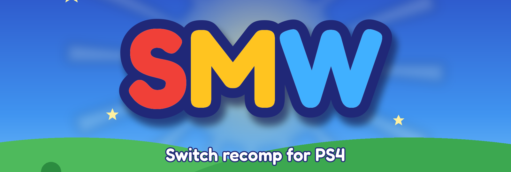
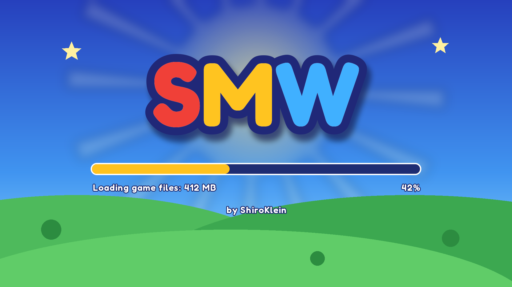
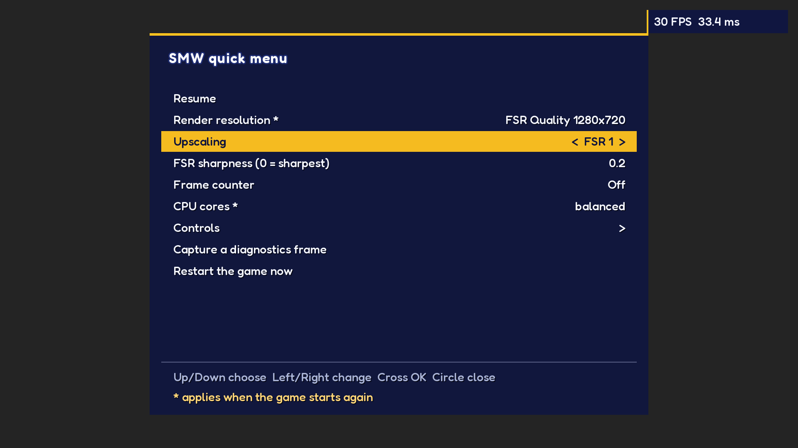
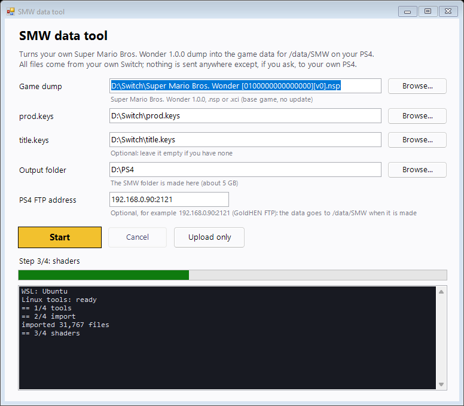

  

  
  
  
  

<h3 align="center">Super Mario Bros. Wonder, running natively on the PS4.</h3>

  <a href="https://github.com/iHaiDeeZ/SMW/releases/latest"><b>⬇ Get the latest release</b></a> ·
  <a href="#getting-started">Getting started</a> ·
  <a href="#controls">Controls</a> ·
  <a href="#the-quick-menu">Quick menu</a> ·
  <a href="#performance">Performance</a> ·
  <a href="#faq">FAQ</a> ·
  <a href="CREDITS.md">Credits</a>

---

## Overview

SMW brings [Super Mario Bros. Wonder Recomp](https://github.com/BelmanteGu/SuperMarioWonderRecomp), BelmanteGu's
static recompilation of the Switch game, to jailbroken PS4 consoles. There's no emulator: the game's ARM code was
translated to C++ ahead of time and compiled for the PS4's CPU, and its NVN graphics run on Vulkan through Mesa's
RADV driver, ported to submit work straight to the PS4's AMD GPU.

It installs as an app on the home screen, shows its own boot screen with a progress bar, and plays with up to
four DualShock 4 controllers. **L3 + R3** opens a quick menu for resolution, FSR upscaling, the frame counter and
button mapping.

You bring your own game: nothing copyrighted is in this repository or its releases. No game code, assets or keys.

## Highlights

**The whole game, natively**
- Upstream's recompiled code, with no interpreter or JIT in between, on the PS4's 7 cores.
- The game's own audio engine, out through the PS4's speakers at 48 kHz.
- Saves in `/data/SMW/user`, kept across updates.

**Made for the PS4's hardware**
- FidelityFX Super Resolution 1 renders at a lower resolution and upscales to 1080p, with four quality modes
  plus native 1080p.
- Render pipelines and the game's ASTC textures are prepared on spare cores in the background, so new objects
  don't stall the frame.
- Submits are pipelined: the CPU starts the next frame while the GPU finishes the last one.

**Couch-friendly**
- Up to four players, each on their own DualShock 4 and PS4 user.
- Any Switch button on any DualShock 4 button, changed from the quick menu while you play.
- A frame counter, top right, when you want one.

**When something goes wrong**
- Logs, crash and freeze reports in `/data/SMW`, and a one-press diagnostics capture of a whole frame.

  
  

## Getting started

**You need:** a jailbroken PS4 with **GoldHEN** (developed on a launch-model PS4), an FTP connection to it, a PC
with Windows 10 or 11 and WSL, and your own **Super Mario Bros. Wonder 1.0.0** dump (`.nsp` or `.xci`, base game)
with your `prod.keys` and `title.keys`, all from your own Switch.

### 1. The game data

1. Download **`SMW-Data-Tool-vXX.XX.zip`** from the [releases page](https://github.com/iHaiDeeZ/SMW/releases/latest)
   and unzip it.
2. Double-click **`windows/SMW-Data-Tool.cmd`**. A window opens: press **Browse...** on each row to pick your
   dump, `prod.keys` and `title.keys` in File Explorer (keys next to the dump are filled in for you), and a folder
   with about 5 GB free.
3. Optionally type your PS4's FTP address (for example `192.168.0.90:2121`), then press **Start**.
4. Wait 20-40 minutes while the log and progress bar follow along. The tool decrypts your dump with upstream's
   importer, translates the game's 12,751 shaders, and lays out an **`SMW`** folder, then uploads it to
   **`/data/SMW`** if you gave an address. Otherwise copy the **contents** of `SMW` there yourself (FileZilla), or
   press **Upload only** later. An interrupted upload resumes where it stopped.

> **First time with WSL?** Open PowerShell as administrator, run `wsl --install -d Ubuntu`, restart, open Ubuntu
> once to create your user, then start the tool. It installs the few Linux tools it needs by itself.

### 2. The package

The SMW package is built from your dump too: its `eboot.bin` is mostly the game's own code, recompiled. That's why
no release can include it, and why you must never share yours. **[docs/BUILDING.md](docs/BUILDING.md)** walks
through building it in WSL. It takes about 10 minutes once the PS4 toolchain is set up.

Install your **`SMW-vXX.XX.pkg`** with GoldHEN's **Package Installer** and start **SMW** from the home screen.

**Updating SMW:** build and install the newer package on top of the old one. The game data and your saves in
`/data/SMW` stay.

## Controls

| DualShock 4 | Switch |
|---|---|
| Cross / Circle | A / B |
| Triangle / Square | X / Y |
| L1 / R1 | L / R |
| L2 / R2 | ZL / ZR |
| OPTIONS | + |
| Touchpad click | − |
| Left / right stick | Left / right stick |
| L3 / R3 | Stick buttons |
| D-pad | D-pad |
| **L3 + R3, held** | **The quick menu** |

Cross confirms, as in every PS4 menu. Prefer Nintendo's layout (A on the right)? Swap them in the quick menu's
**Controls**, or put `NX_BUTTONS=nintendo` in `/data/SMW/config.txt`.

## The quick menu

Hold **L3 + R3** for half a second while playing. The game pauses under the menu; **Circle** or **L3 + R3**
closes it, and your choices are saved.

| Item | What it does | Applies |
|---|---|---|
| Render resolution | Native 1920x1080, FSR Ultra Quality (1476x830), Quality (1280x720, the default), Balanced (1128x634), Performance (960x540), or the game's handheld mode | Next start |
| Upscaling | FSR 1, or a plain bilinear stretch | At once |
| FSR sharpness | 0 (sharpest) to 2 (none) | At once |
| Frame counter | Off, FPS, or FPS and frame time | At once |
| CPU cores | Balanced, pinned or spread (see [docs/BUILDING.md](docs/BUILDING.md#cores)) | Next start |
| Controls | Pick a Switch button, press the DualShock 4 button you want for it | At once |
| Capture a diagnostics frame | Saves every pass of the next frame to `/data/SMW/diag` | Next frame |
| Restart the game now | Restarts SMW, to apply the "next start" items | |

## Performance

Measured on a launch-model PS4 in course 1-1, at the default **FSR Quality**:

| Where | Frames per second |
|---|---|
| Menus, world map | 60 |
| Courses | ~30, the game's own rate when a frame can't make 60 |

The PS4's CPU is the limit: about 23 ms of each course frame goes to turning the game's NVN commands into Vulkan.
FSR Quality or Balanced keeps 30 steadier than native 1080p. The first time an area loads, its pipelines and
textures are prepared in the background, so an object can appear a frame or two late. They're kept for next time.

FSR 2 and 3 aren't offered: they need motion vectors and a jittered camera from the game, which Wonder doesn't
render, and their GPU cost doesn't fit next to the game on a PS4. FSR 1 works on the finished picture alone.

## Your files

Everything lives in **`/data/SMW/`**:

- `analysis/`, `extract/romfs/`, `spirv/`: the game data from the data tool (your game, keep it to yourself)
- `user/`: your saves
- `config.txt`: your settings (`NX_<KEY>=<value>` lines; the quick menu writes them)
- `pipelines_*.bin`: the pipeline cache
- `nx.log`, `boot-trace.log`, `crash.log`, `hang.log`: logs and reports for bug reports
- `diag/`: diagnostics captures

## FAQ

**Why isn't there a package to download?**
The package is the game: its `eboot.bin` holds Super Mario Bros. Wonder's code, recompiled from a dump. Sharing it
would be sharing Nintendo's game, so everyone builds their own from their own copy.

**Why does the first start take a while?**
The boot screen shows the game data loading from the PS4's drive (about 15 seconds once the caches are warm). The
first minutes in a new area also prepare pipelines and textures in the background.

**The game slows down in busy scenes.**
The PS4's CPU is the bottleneck. Use FSR Quality or Balanced in the quick menu; on a PS4 Pro, turn on **Boost
Mode** in the PS4's settings.

**Something looks wrong or crashes.**
Make sure the data came from version 1.0.0 of the game and that the whole `SMW` folder reached `/data/SMW`. Then
[open an issue](https://github.com/iHaiDeeZ/SMW/issues) with `nx.log`, `boot-trace.log` and `crash.log` or
`hang.log` from `/data/SMW/`, the SMW version, your PS4 model and firmware. Never attach game files.

## Good to know

- Only version 1.0.0 of the game is supported, without updates or DLC (upstream's target).
- Upstream's own settings (`NX_*`, in its `docs/nvn/SWITCHES.md`) work in `config.txt` too.
- Only the original PS4 has been tested so far. PS4 Pro reports are welcome.

## Thanks

- **[BelmanteGu](https://github.com/BelmanteGu)** and **[Super Mario Bros. Wonder Recomp](https://github.com/BelmanteGu/SuperMarioWonderRecomp)**:
  the recompilation, the runtime and its NVN-on-Vulkan layer, the importer and shader tools
- **[Ryujinx](https://ryujinx.app) / [Ryubing](https://codeberg.org/Software_arch/Ryubing)**: the Maxwell shader
  translator
- **[Mesa](https://mesa3d.org)**: the RADV Vulkan driver that draws every frame
- **[OpenOrbis](https://github.com/OpenOrbis)** and **[PacBrew](https://github.com/PacBrew)**: the PS4 toolchains
- **[AMD FidelityFX](https://gpuopen.com/fidelityfx-superresolution/)**: FSR 1
- **[Fredoka](https://github.com/hafontia-zz/Fredoka-One)**: the lettering of the boot screen and menus

Everyone involved, with licences, is listed in **[CREDITS.md](CREDITS.md)**.

## License and disclaimer

Released under the **MIT License**, as upstream. See [LICENSE](LICENSE). The PS4 runtime pieces come from
[Resonance](https://github.com/iHaiDeeZ/Resonance), [DolphinPS4](https://github.com/iHaiDeeZ/DolphinPS4) and
[Crema](https://github.com/iHaiDeeZ/Crema).

This is a fan-made project with no ties to Nintendo, Sony Interactive Entertainment or the upstream project's
authors. Super Mario Bros. Wonder and Nintendo Switch are trademarks of Nintendo; PlayStation and PS4 are
trademarks of Sony Interactive Entertainment. Please only play games you own. This project won't help you find or
share game files or keys.
